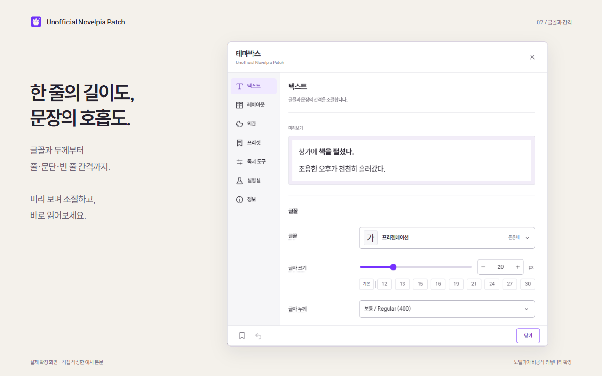
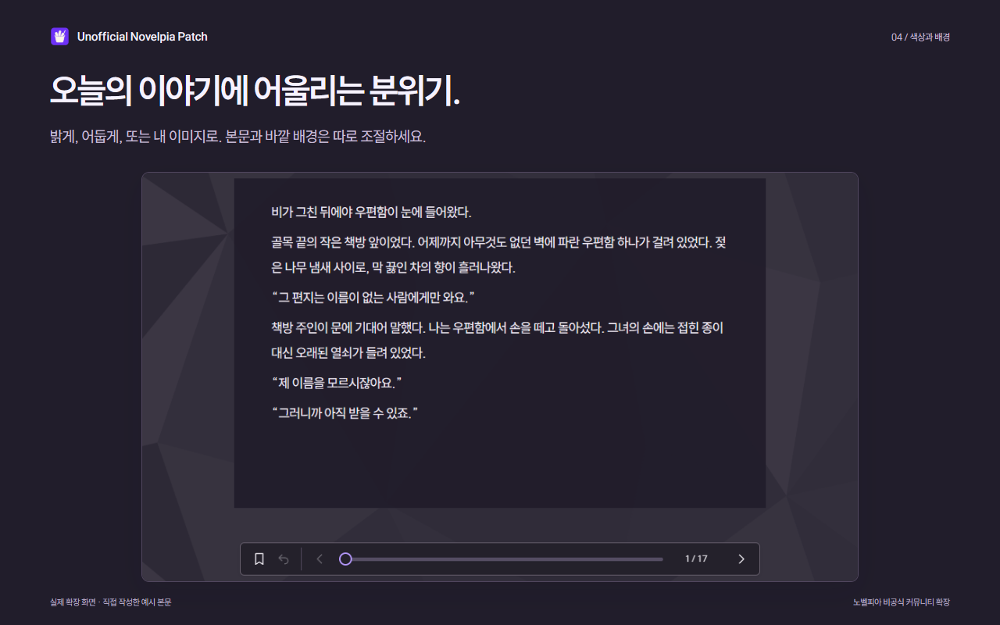
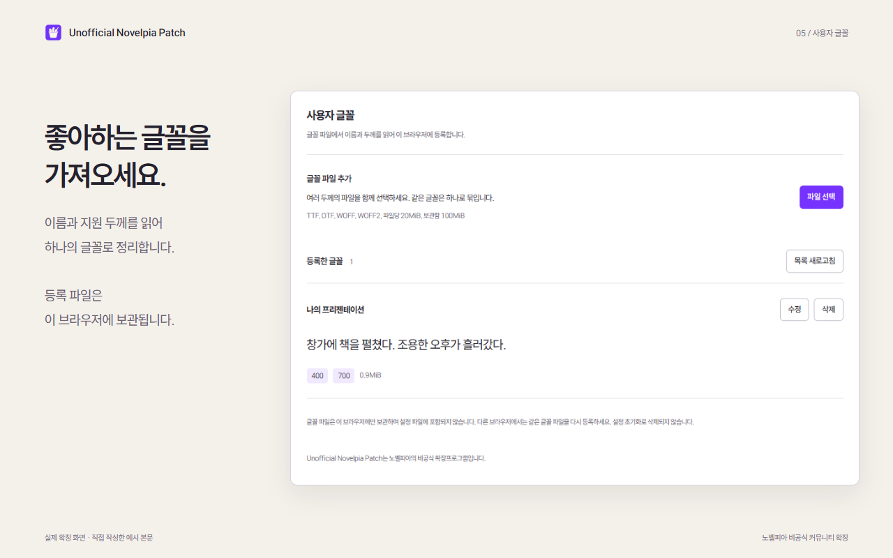

  
  <h1>Unofficial Novelpia Patch</h1>
  
<strong>읽는 방식부터, 내 취향대로.</strong>

  
노벨피아 뷰어의 글꼴·여백·배경을 바꾸고, 스크롤이나 책처럼 넘기는 화면으로 읽을 수 있는 비공식 Chrome 확장프로그램입니다.

  
<a href="docs/INSTALLATION.md">설치 안내</a> · <a href="docs/USAGE.md">사용 안내</a> · <a href="docs/FAQ.md">자주 묻는 질문</a> · <a href="https://github.com/jukrap/unofficial-novelpia-patch/issues/new/choose">문의·제안</a>

  
Chrome 120 이상 · MIT License

## 설치

현재 Chrome 웹 스토어 심사 중입니다. 승인 후 설치 링크를 안내하겠습니다.

먼저 사용해 보려면 [최신 릴리스](https://github.com/jukrap/unofficial-novelpia-patch/releases/latest)의 ZIP을 받아 [개발자 모드 설치 안내](docs/INSTALLATION.md#개발자-모드로-설치)를 따라 설치하세요.

## 주요 기능

- **읽기 화면:** 스크롤·한 쪽·두 쪽 읽기, 본문 너비와 높이, 여백, 하단 진행바 배치
- **글꼴과 간격:** 글자 크기·두께, 줄·문단·빈 줄 간격, 작가의 강조 표시, 내 글꼴 파일 등록
- **배경과 프리셋:** 밝은색·어두운색 테마, 이미지 배경, 기본 프리셋 10개와 내 프리셋 편집·복제
- **이어보기와 기록:** 회차별 읽던 위치, 수동 북마크, 이 브라우저의 독서 통계
- **설정 보관:** 읽기 설정과 내 프리셋을 JSON 파일로 내보내기·가져오기

## 화면 미리보기

<table>
  <tr>
    <td width="50%"> <strong>글꼴과 간격</strong></td>
    <td width="50%"> <strong>프리셋</strong></td>
  </tr>
  <tr>
    <td> <strong>이미지 배경</strong></td>
    <td> <strong>사용자 글꼴</strong></td>
  </tr>
</table>

예시 본문으로 촬영한 화면입니다. 이미지를 누르면 크게 볼 수 있습니다.

## 사용 방법

1. 노벨피아에서 읽을 회차를 열고 **테마박스** 버튼을 누릅니다.
2. **프리셋**을 골라 적용하거나 **텍스트·레이아웃·외관**에서 직접 조절합니다. 설정은 자동으로 저장됩니다.
3. 마음에 드는 설정은 **현재 설정으로 만들기**로 저장해 두세요.

확장 아이콘의 **설정 열기**에서는 글꼴 파일, 설정 파일과 독서 통계도 관리할 수 있습니다. 기본 뷰어로 돌아가려면 **확장 뷰어 사용**을 끄세요.

## 사용 전에 알아두세요

- 커버가 있는 쪽과 마지막 쪽은 페이지 전환 효과 없이 넘깁니다.
- 90% 이상 읽은 회차를 다시 열면 처음부터 시작합니다. 수동 북마크는 그대로 남습니다.
- 설정 JSON에는 등록한 글꼴·이미지 파일과 읽기 기록이 포함되지 않습니다. 다른 브라우저나 스토어 확장으로 옮길 때는 [설정 이전 안내](docs/INSTALLATION.md#개발용-확장에서-스토어-확장으로-이전)를 확인하세요.
- 노벨피아 사이트가 변경되면 일부 기능이 제대로 작동하지 않을 수 있습니다. 문제가 생기면 [자주 묻는 질문](docs/FAQ.md)을 확인하거나 [문제를 신고](https://github.com/jukrap/unofficial-novelpia-patch/issues/new/choose)해 주세요.

읽기 설정과 프리셋은 Chrome 설정에 따라 동기화될 수 있습니다. 등록 파일과 읽기 기록은 이 브라우저에 보관하며 개발자 서버로 보내지 않습니다. 웹글꼴이나 이미지 주소를 사용하면 해당 제공처에 요청이 발생합니다. 자세한 내용은 [개인정보 안내](docs/PRIVACY.md)에 정리했습니다.

## 개발에 참여하기

오류 제보와 기능 제안, 코드 기여를 환영합니다. 코드를 수정하기 전에는 [개발 환경](docs/DEVELOPMENT.md)과 [기여 안내](CONTRIBUTING.md)를 확인해 주세요. PR은 `develop` 브랜치로 보내 주세요.

[전체 문서](docs/README.md) · [변경 이력](CHANGELOG.md) · [보안 제보](SECURITY.md)

## 비공식 프로젝트 안내

이 확장프로그램은 노벨피아와 공식적인 관계가 없으며, 광고·결제·회차 접근 권한을 우회하지 않습니다. 노벨피아 측의 요청이나 문제가 확인되면 수정, 배포 중단 또는 공개 자료 삭제 등의 조치를 취할 수 있습니다.

소스 코드는 [MIT License](LICENSE)로 제공합니다. 동봉 글꼴과 라이브러리의 사용 조건은 [제3자 고지](public/THIRD_PARTY_NOTICES.txt)에서 확인할 수 있습니다.
