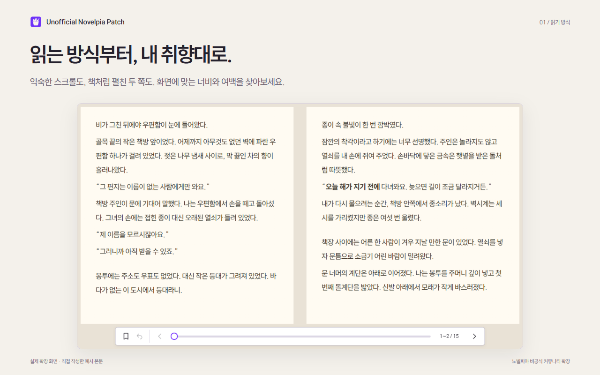
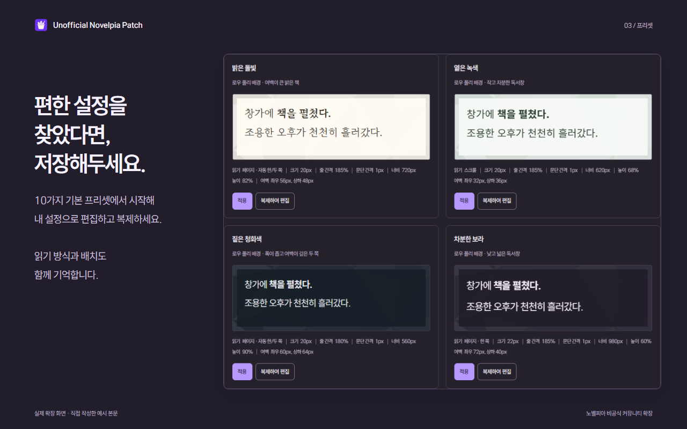

  
  <h1>Unofficial Novelpia Patch</h1>
  
<strong>읽는 방식부터, 내 취향대로.</strong>

  
글꼴과 여백, 테마와 페이지 읽기까지. 노벨피아 웹소설을 내게 편한 화면으로 읽는 비공식 Chrome 확장프로그램입니다.

  
<a href="docs/INSTALLATION.md">설치</a> · <a href="docs/USAGE.md">사용 안내</a> · <a href="docs/FAQ.md">문제 해결</a> · <a href="https://github.com/jukrap/unofficial-novelpia-patch/issues/new/choose">문의·제안</a>

  
Chrome 120 이상 · 한국어 · MIT License

> **스토어 등록 준비 중** — 현재 버전은 첫 등록을 위한 릴리스 후보입니다. 스토어 설치 링크는 심사 승인 후 추가합니다. 지금 사용하려면 [개발자 모드 설치](docs/INSTALLATION.md#개발자-모드로-설치)를 참고하세요.

## 읽기 화면을 바꾸는 여섯 가지 방법

| 원하는 읽기 경험                       | 사용할 기능                                             |
| -------------------------------------- | ------------------------------------------------------- |
| 스크롤 대신 책처럼 넘기고 싶을 때      | 스크롤·한 쪽·자동 두 쪽 읽기, 페이지 효과와 하단 진행바 |
| 한 줄이 너무 길거나 글자가 답답할 때   | 본문 너비·높이·여백, 글자 크기·두께, 줄·문단·빈 줄 간격 |
| 내 취향의 글꼴로 읽고 싶을 때          | 웹글꼴 목록과 TTF·OTF·WOFF·WOFF2 파일 등록              |
| 낮과 밤에 다른 분위기로 읽을 때        | 밝은색·어두운색 테마, 본문 색상·농도, 이미지 배경       |
| 좋은 설정을 매번 다시 맞추기 싫을 때   | 기본 프리셋 10개, 내 프리셋 생성·편집·복제, 설정 JSON   |
| 읽던 곳과 독서 습관을 기억하고 싶을 때 | 회차별 자동 이어보기, 수동 북마크, 로컬 독서 통계       |

본문과 설정창은 같은 값을 사용합니다. 테마박스에서 조절한 글꼴과 간격은 바로 읽기 화면에 반영되고, 별도 설정 페이지에서도 이어서 관리할 수 있습니다.

## 화면으로 살펴보기

<table>
  <tr>
    <td width="50%"></td>
    <td width="50%"></td>
  </tr>
  <tr>
    <td><strong>미리 보며 조절하는 테마박스</strong> 글꼴·간격·배치를 한곳에서 다룹니다.</td>
    <td><strong>나만의 설정을 만드는 프리셋</strong> 10가지 시작점에서 골라 저장하고 복제합니다.</td>
  </tr>
</table>

모든 화면은 실제 확장을 실행해 촬영했습니다. 작품 원문 대신 직접 작성한 예시 본문을 사용했으며, 설명 문구는 화면 바깥에 배치했습니다. [배경과 사용자 글꼴 화면 더 보기](store/assets/README.md)

## 1분 만에 시작하기

1. 확장을 설치한 뒤, 노벨피아에서 정상적으로 읽을 수 있는 회차를 엽니다.
2. 기존 **테마박스** 버튼을 눌러 **프리셋**에서 마음에 드는 모습을 적용합니다.
3. **텍스트·레이아웃·외관**에서 조금씩 조절합니다. 일반 설정은 자동 저장됩니다.
4. 마음에 들면 **현재 설정으로 만들기**로 나만의 프리셋을 저장합니다.

확장 아이콘의 **설정 열기**에서는 사용자 글꼴, 설정 파일과 독서 통계를 관리합니다. **확장 뷰어 사용**을 끄면 기본 뷰어로 돌아갈 수 있습니다. 읽기 방식이나 확장 사용 여부를 바꾸면 현재 회차를 새로고침합니다.

## 기록은 어디에 보관하나요?

별도의 확장 계정이나 개발자 서버에 로그인할 필요가 없습니다.

- **읽기 설정·프리셋:** Chrome 동기화 저장소. Chrome 설정에 따라 다른 기기에 동기화될 수 있습니다.
- **읽던 위치·북마크·독서 통계:** 이 브라우저의 확장 로컬 저장소.
- **등록한 이미지·글꼴 파일:** 이 브라우저의 확장 IndexedDB. 개발자에게 업로드하지 않습니다.

웹글꼴과 사용자가 입력한 이미지 주소는 해당 제공처에 자원 요청을 보냅니다. 독서에 쓰는 외부 자원을 줄이려면 시스템/등록 글꼴과 단색/내장/등록 이미지 배경을 사용하세요. 글꼴 목록의 미리보기에서도 웹글꼴을 요청할 수 있습니다. [개인정보 처리 안내](docs/PRIVACY.md)

## 설치와 업데이트

[설치 안내](docs/INSTALLATION.md)에서 소스 빌드, 압축해제된 확장 로드와 업데이트 방법을 확인할 수 있습니다. 개발용 확장과 스토어 확장은 ID가 다를 수 있으므로, 이전하기 전에 설정 파일을 내보내세요.

설정 JSON에는 등록한 글꼴·이미지의 **실제 파일**, 읽던 위치·북마크·통계가 포함되지 않습니다. [옮길 수 있는 항목과 재등록 방법](docs/INSTALLATION.md#개발용-확장에서-스토어-확장으로-이전)

## 알아두면 좋은 점

- 페이지 효과는 중간 본문 쪽에 적용됩니다. **커버가 있는 쪽과 마지막 쪽**은 서비스 영역과 겹치지 않도록 효과 없이 넘깁니다.
- **90% 이상 읽은 회차**를 다시 열면 처음부터 시작합니다. 따로 저장한 수동 북마크는 유지됩니다.
- 원사이트 화면이 변경되면 일부 기능에 수정이 필요할 수 있습니다. 확장을 업데이트한 뒤에는 열려 있던 회차도 새로고침하세요.
- 자동 추천은 실험실에서 직접 켠 경우에만 동작합니다. 기본값은 꺼짐입니다.

지원 범위와 자세한 동작은 [사용 안내](docs/USAGE.md), 오류 해결은 [FAQ](docs/FAQ.md)를 참고하세요.

## 함께 개선하기

버그를 발견했거나 필요한 기능이 있다면 [이슈 양식](https://github.com/jukrap/unofficial-novelpia-patch/issues/new/choose)으로 알려주세요. 사용 환경과 재현 순서가 있으면 확인하기 쉽습니다. 화면을 첨부할 때는 작품 원문과 계정 정보를 가려 주세요.

개발 참여는 [기여 안내](CONTRIBUTING.md)부터 시작합니다. WXT·React·TypeScript를 사용하며, 작업 PR은 `develop`으로 보냅니다.

[문서 목차](docs/README.md) · [개발 환경](docs/DEVELOPMENT.md) · [구조](docs/ARCHITECTURE.md) · [변경 이력](CHANGELOG.md) · [보안 제보](SECURITY.md)

## 비공식 프로젝트와 라이선스

이 프로젝트는 노벨피아와 공식적인 관계가 없습니다. 노벨피아 계정·결제·회차 접근 권한을 대신하지 않으며 광고나 서비스 요청을 우회하지 않습니다. 원사이트 측의 요청이나 문제가 확인되면 수정, 배포 중단 또는 공개 자료 삭제 등의 조치를 취할 수 있습니다.

소스 코드는 [MIT License](LICENSE)로 제공합니다. 동봉 글꼴과 라이브러리에는 각각의 라이선스가 적용됩니다. [제3자 고지](public/THIRD_PARTY_NOTICES.txt) · [글꼴 출처](public/licenses/Reading-Font-Sources.txt)
