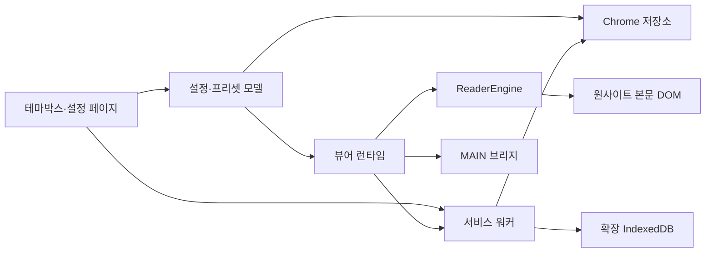

# 구조와 데이터 흐름

이 문서는 현재 구현의 책임과 변경 지점을 설명합니다. 사용 방법은 [사용 안내](USAGE.md), 실행 명령은 [개발 안내](DEVELOPMENT.md)를 참고하세요.

## 실행 영역

| 영역             | 진입점                                             | 책임                                                        |
| ---------------- | -------------------------------------------------- | ----------------------------------------------------------- |
| 콘텐츠 스크립트  | `src/entrypoints/content.ts`                       | 초기 표시 준비, 확장 내부 독서 런타임 로딩과 연결 종료 처리 |
| 사이트 MAIN 영역 | `src/entrypoints/native.content.ts`                | 허용한 원사이트 설정·상태·이동을 연결하는 브리지            |
| 서비스 워커      | `src/entrypoints/background.ts`                    | 등록 파일, 자동 위치·통계 기록, 뷰어 전환 처리              |
| 설정 페이지·팝업 | `src/entrypoints/options`, `src/entrypoints/popup` | React 화면의 진입점                                         |

콘텐츠 스크립트의 조립은 `src/app/runtime/viewer.tsx`, 설정창과 탐색바의 연결은 `src/app/ui`에 있습니다. 사이트에 삽입하는 설정 UI는 Shadow DOM으로 사이트 CSS와 분리합니다. `ReaderEngine`은 사이트가 제공한 본문 DOM을 측정하고 배치하며, 본문 전체를 React로 다시 렌더링하지 않습니다.

그림의 화살표는 데이터 흐름이며 FSD import 허용 방향을 대신하지 않습니다. 브리지로 연결한 기능을 제외한 사이트 요청·광고·결제·접근 권한 처리는 원사이트에 남깁니다.

## FSD에서 변경할 위치

`entrypoints`와 `app`은 조립, `pages`는 화면, `widgets`는 설정창·탐색바, `features`는 사용자 동작을 담당합니다. `entities`에는 설정·프리셋·독서 엔진·등록 글꼴·통계가 있고, `shared`에는 공통 계약과 환경 어댑터가 있습니다.

| 바꾸려는 동작                        | 먼저 확인할 위치                                          |
| ------------------------------------ | --------------------------------------------------------- |
| 설정 검증·새 기본값·프리셋 적용 범위 | `src/shared/model/preferences.ts`                         |
| 설정 저장·이전·다른 탭의 변경 수신   | `src/entities/settings/model/store.ts`                    |
| 기본 프리셋·독립 편집·저장 충돌      | `src/entities/preset/config`, `src/entities/preset/model` |
| 페이지 측정·앵커·복원                | `src/entities/reader/model`, `src/entities/reader/lib`    |
| 배경·보조 영역·페이지 효과 표시      | `src/entities/reader/ui`                                  |
| 글꼴 파일 분석·등록                  | `src/entities/local-fonts`                                |
| 로컬 이미지 보관과 메시지 검증       | `src/shared/platform/background-assets-server.ts`         |
| 독서 시간과 기록 동의 상태           | `src/entities/reading-stats`                              |
| 공통 설정 화면                       | `src/widgets/settings-panel`                              |

slice 밖에서는 공개 `index.ts`를 사용합니다. 공통 설정 타입과 플랫폼 어댑터의 소유권을 이름만 보고 옮기지 않습니다. 실제 import 경계는 `scripts/fsd-rule.mjs`와 ESLint가 정적 import 및 문자열 동적 import를 검사합니다.

## 시작과 지연 로딩

초기 스크립트는 `unp.startup.v1`의 표시 정보를 읽어 첫 배치 전에 색상을 준비합니다. `src/app/runtime/bootstrap.ts`와 `first-display.ts`는 초기화 실패 복구와 글꼴·배경·위치 준비를 구분합니다. 이미 공개한 본문은 늦은 자원 때문에 다시 숨기지 않습니다.

첫 표시에는 읽던 위치 조회, 원사이트 테마 동기화, 진행바 모듈·글꼴과 배치 안정화를 함께 기다립니다. 자원 대기 3초가 끝나도 위치 복원·배치 준비를 건너뛰지 않습니다. 위치 조회는 5초 후 실패로 처리하며, 읽지 못한 기록을 덮어쓰거나 늦은 응답으로 이동하지 않습니다. `reading-reveal.ts`는 본문 글자와 확장이 그린 배경·진행바만 함께 페이드하고 서비스 요소가 들어 있는 부모는 숨기지 않습니다. 독서 통계는 페이드가 끝난 뒤 시작합니다.

`modules/esm-reader.ts`가 독서 런타임을 확장 내부 ESM으로 별도 빌드합니다. `startup.json`에는 시작에 필요한 정적 모듈만 기록합니다. 설정창·프리셋 편집기·종이 효과는 필요할 때 로딩하며, 이 파일들도 배포 ZIP에 포함됩니다. 네트워크에서 JavaScript를 받아 실행하지 않습니다.

확장 새로고침으로 기존 탭의 실행 컨텍스트가 사라지면 이전 코드가 계속 저장을 시도하지 않도록 정리합니다. 브라우저 재시작·페이지 복원 처리와 이 종료 처리는 서로 다른 수명주기입니다.

## 저장 데이터의 경계

설정·프리셋·통계 클라이언트의 관찰 가능한 상태는 `zustand/vanilla`로 관리합니다. React 화면은 필요한 상태를 selector로 구독하고, 본문 엔진은 기존 `getSnapshot`·`subscribe` 계약을 사용합니다. Chrome 저장·쓰기 순서·이전·충돌 처리는 각 모델의 책임이며 Zustand의 자동 persist로 대체하지 않습니다. 팝업·설정 페이지·콘텐츠 스크립트는 서로 다른 실행 영역이므로 Chrome 저장소 알림과 메시지 연결도 유지합니다.

## 화면 이동과 모션

별도 설정 페이지는 React Router의 HashRouter를 사용합니다. `options.html#/presets`, `#/text`, `#/fonts`, `#/files`처럼 실제 파일 경로를 유지한 채 화면을 구분합니다. 처음 방문한 화면만 준비하고 이미 방문한 화면은 유지해 뒤로·앞으로 가기와 메뉴 이동 중 편집 초안이 사라지지 않게 합니다. 새로고침은 현재 메뉴를 유지하지만 저장하지 않은 초안을 디스크에 보관하지는 않습니다. 알 수 없는 경로는 홈으로 교체합니다. 사이트의 회차 이동은 이 라우터로 처리하지 않습니다.

Motion의 시간 규격은 `src/shared/config/motion.ts`에 있습니다. React 컨트롤은 공통 Motion 컴포넌트를, 원사이트 DOM을 다루는 본문·배경·초기 로더는 `motion/mini` 어댑터를 사용합니다. 어댑터는 취소 시 원래 인라인 스타일을 복원해 다음 페이지 측정을 방해하지 않습니다. 시스템의 동작 줄이기 설정을 따르고 버튼 크기나 본문 높이를 장식적으로 움직이지 않습니다. 종이 효과의 계산은 기존 page-flip에 남깁니다. 브라우저의 팝오버 외부 클릭 닫기는 즉시 처리하고, 명시적인 닫기에는 짧은 페이드를 사용합니다.

## 저장 위치

| 데이터                          | 위치                 | 설정 파일에 포함                                   |
| ------------------------------- | -------------------- | -------------------------------------------------- |
| 읽기 설정·사용자 프리셋         | Chrome 동기화 저장소 | 포함. 동의·전역 상태의 적용은 가져오기 규칙을 따름 |
| 자동 위치·수동 북마크·독서 통계 | Chrome 로컬 저장소   | 제외                                               |
| 초기 표시 캐시·최근 색상        | Chrome 로컬 저장소   | 제외                                               |
| 등록 이미지·글꼴 본문           | 확장 출처 IndexedDB  | 제외. 설정·프리셋에는 참조만 포함                  |

`SettingsStore`는 `unp.reader.v1`의 스키마 1 문서를 읽습니다. 실제 새 기본값은 `preferences.ts`의 `defaults`입니다. `base-settings.ts`는 과거 프리셋의 기준값도 보존하므로 새 기본값을 고치기 위해 일괄 수정하지 않습니다.

`PRESET_SETTING_KEYS`는 프리셋 적용·저장·동일성 비교의 공통 기준입니다. `PresetDraft`는 현재 본문과 별개인 초안이고, 저장과 적용은 별도 동작입니다. 외부 수정 충돌이나 저장 실패가 나도 초안을 조용히 버리지 않습니다.

스크롤·페이지 선택과 페이지 옵션은 설정·프리셋에 포함됩니다. `app/runtime/reading-mode.ts`가 공유 설정의 읽기 방식을 기존 native adapter와 연결합니다. 선택값과 위치를 저장한 뒤 원사이트의 전환 기능을 호출하고, 기본 뷰어로 돌아갈 때 처음 변경 직전의 사이트 값을 복원합니다. 값이 없는 구형 설정은 원사이트 방식을 한 번 가져오며, 구형 프리셋은 기존 읽기 옵션을 유지합니다. 공통 `ReadingModeFields`는 설정 화면과 독립 편집 초안에서 같은 옵션을 제공합니다.

파일 참조를 다른 환경으로 가져왔다고 실제 파일까지 생기지는 않습니다. 누락 파일의 대체 표시와 재등록을 처리해야 합니다. 동기화·외부 요청·삭제의 전체 설명은 [개인정보 안내](PRIVACY.md)에 있습니다.

## 읽기 위치와 서비스 영역

위치는 회차·논리 블록·블록 안 글자 위치를 나타내는 앵커로 유지합니다. 자동 이어보기와 수동 북마크는 별개입니다. 최초 조회가 끝나기 전에 시작 위치로 과거 기록을 덮어쓰지 않고, 조회 중 사용자의 독서 이동을 우선합니다.

페이지 크기는 브라우저의 실제 배치와 글자 좌표를 측정합니다. 본문 높이·두 쪽 간격·진행바 배치를 바꿀 때도 앵커를 다시 계산합니다. 마지막 쪽과 커버가 보이는 쪽으로 들어가거나 나올 때는 설정한 페이지 효과를 생략합니다. 광고·버튼 같은 서비스 요소를 복제해서 효과를 만들지 않습니다.

새 저장 키, 페이지 계산 또는 파일 형식을 바꾸면 [개발 안내](DEVELOPMENT.md)의 관련 회귀 검사를 선택하고, 기존 설정·프리셋·읽기 위치와의 호환성을 함께 확인하세요.
