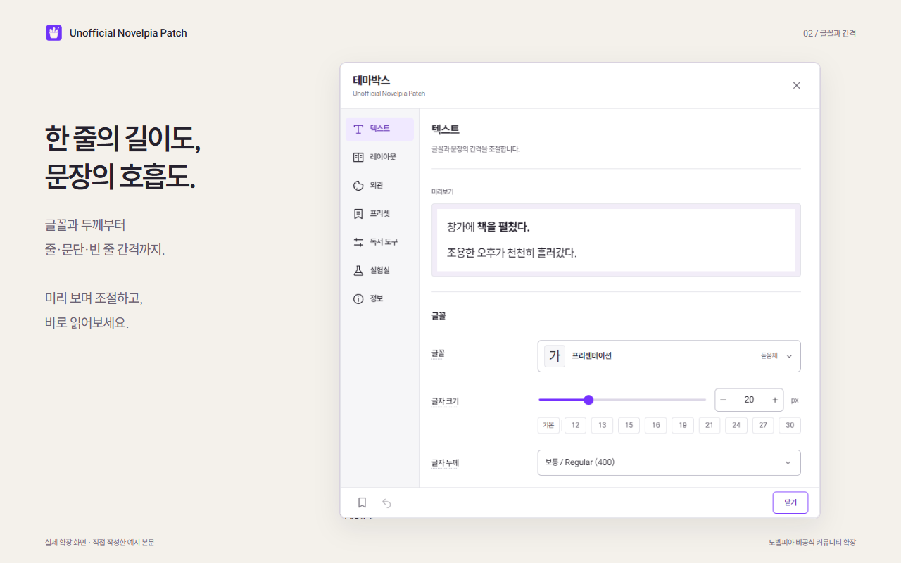

# 사용 안내

[Chrome 웹 스토어에서 설치](https://chromewebstore.google.com/detail/unofficial-novelpia-patch/iijfbkikffomenjplfdpfgdbbfnhcpdo)한 뒤, 노벨피아 회차를 새로고침하고 테마박스를 열어 주세요.

**프리셋으로 시작해 마음에 드는 부분만 바꾸는 방법**을 권합니다. 프리셋은 적용하기 전에 살펴볼 수 있고, 내 프리셋으로 복제해 따로 저장할 수 있습니다.

1. 회차에서 테마박스를 열고 **프리셋 → 적용**을 누릅니다.
2. **텍스트·레이아웃·외관**에서 글꼴과 읽기 영역을 조절합니다.
3. 설정이 마음에 들면 **현재 설정으로 만들기**로 저장합니다.

설치·업데이트는 [설치 안내](INSTALLATION.md), 오류와 제한은 [자주 묻는 질문](FAQ.md), 데이터 처리 범위는 [개인정보 안내](PRIVACY.md)를 참고하세요.

## 테마박스와 설정 페이지

회차를 읽는 중에는 노벨피아의 테마박스 버튼으로 설정을 엽니다. 확장 아이콘의 **설정 열기**는 별도 설정 페이지를 엽니다. 두 화면은 같은 읽기 설정을 사용하며 일반 설정 변경은 자동 저장됩니다.

설정 페이지에서는 브라우저의 뒤로·앞으로 가기로 메뉴를 이동할 수 있습니다. 메뉴를 오가도 작성 중인 프리셋과 가져오기 입력은 유지됩니다. 주소 끝의 `#/fonts`, `#/presets` 등으로 해당 화면을 바로 열 수 있고 새로고침하면 같은 메뉴가 열립니다. 저장하지 않은 초안은 새로고침하거나 창을 닫으면 사라집니다.

읽기 방식은 두 화면의 **레이아웃**에서 조절합니다. 정주행과 본문 탐색처럼 현재 회차에 연결된 기능은 뷰어의 테마박스에서, 사용자 글꼴 파일·설정 파일·통계 관리는 별도 설정 페이지에서 제공합니다.

**정보 → 확장 뷰어 사용**을 끄면 기본 뷰어로 전환합니다. 현재 회차에서 전환하면 새로고침하며 다른 열린 회차에는 새로고침 안내를 표시합니다. 기본 테마박스의 고급옵션이나 확장 팝업에서 다시 켤 수 있습니다.

## 글꼴과 간격

| 설정        | 바뀌는 부분                                             |
| ----------- | ------------------------------------------------------- |
| 줄 간격     | 글자 크기에 대한 한 줄 높이의 비율                      |
| 문단 간격   | 작가가 줄을 나눈 문단 뒤에 더하는 여백                  |
| 빈 줄 간격  | 원문에 있는 빈 줄의 높이                                |
| 자간        | 글자 사이의 간격                                        |
| 줄바꿈 방식 | 한글·영문을 언어별, 단어 또는 글자 기준으로 나누는 방법 |

글자 두께에는 선택한 글꼴이 제공하는 값을 표시합니다. 굵은 서체가 없는 글꼴에는 **강제로 굵게**를 제공합니다. 본문을 굵게 사용해 작가의 강조가 잘 구분되지 않는다면 **굵은 텍스트 강조**에서 그림자, 배경 또는 테두리를 함께 선택하세요.

기본 제공 독서용 글꼴은 시스템 글꼴을 제외하면 웹글꼴입니다. 선택하거나 목록에서 미리 볼 때 필요한 자원을 불러옵니다. 확장 UI에 사용하는 프리젠테이션 글꼴은 확장에 포함되어 있습니다.

### 사용자 글꼴 등록

1. 별도 설정 페이지의 **사용자 글꼴 → 파일 선택**을 누릅니다.
2. TTF, OTF, WOFF 또는 WOFF2 파일을 선택합니다. 여러 두께의 파일을 함께 선택할 수 있습니다.
3. 자동으로 읽은 글꼴 이름과 두께를 확인하고 표시 이름을 정한 뒤 저장합니다.
4. 글꼴 선택기의 **사용자** 분류에서 등록한 글꼴을 선택합니다.

파일당 20MiB, 한 번에 32MiB·24개까지 선택할 수 있습니다. 보관함은 100MiB·100종까지 지원합니다. 같은 글꼴의 두께가 겹치는 파일은 하나만 남겨야 합니다. 브라우저가 읽을 수 없거나 지원 범위를 확인할 수 없는 파일은 등록되지 않습니다.

글꼴 파일은 이 브라우저의 확장 저장소에만 보관합니다. 다른 브라우저에서 사용하려면 같은 파일을 다시 등록해야 합니다. 사용할 권한이 있는 글꼴만 등록하세요.

## 읽기 영역과 페이지 효과

**본문 너비**는 스크롤 방식의 최대 너비, 페이지 방식의 한 쪽 너비입니다. **본문 높이**는 화면에서 읽기 영역이 차지하는 비율이며 줄이면 세로 가운데에 배치합니다.

스크롤·페이지 방식, 페이지 구성·효과와 하단 진행바 배치는 확장 설정에 저장됩니다. 다른 회차를 열거나 브라우저를 다시 실행해도 유지되며 설정 파일에도 포함됩니다. 읽기 방식을 바꾸면 열린 확장 뷰어는 읽던 위치를 저장한 뒤 새로고침합니다.

이전 버전의 설정에 읽기 방식이 없다면 처음 연 회차의 원사이트 방식을 한 번 가져옵니다. 이후에는 확장에 저장한 방식을 사용합니다. 기본 뷰어로 전환할 때는 확장이 처음 변경하기 직전의 원사이트 방식을 복원합니다.

페이지 구성의 **자동**은 공간이 충분할 때 두 쪽을 표시합니다. **항상 한 쪽**은 넓은 화면에서도 한 쪽만 표시합니다. 두 쪽 사이 간격은 0~400px이며, 두 쪽과 간격이 화면에 들어가지 않으면 한 쪽으로 바뀝니다.

하단 진행바는 다음 세 방식 중 선택합니다.

- **하단 고정:** 공간을 확보하고 전체 뷰어 하단에 표시합니다.
- **본문 아래:** 공간을 확보하고 본문 높이에 맞춰 아래에 표시합니다.
- **본문 위:** 본문 높이를 줄이지 않고 본문 위에 겹쳐 표시합니다.

페이지 효과는 없음, 옆으로 밀기, 페이드, 종이 회전, 종이 접힘을 제공합니다. **커버가 있는 쪽과 마지막 쪽을 오갈 때는 효과 없이 전환합니다.** 본문과 서비스 영역의 표시가 겹치지 않게 하기 위한 제한입니다. 운영체제의 동작 줄이기 설정을 사용하면 페이지 효과와 이미지 페이드를 생략합니다.

## 색상과 배경

바깥 배경과 글자가 놓이는 본문 배경은 따로 조절합니다. 이미지 배경은 **기본 배경 / 주소 / 파일** 중 선택합니다. 기본 배경 4종은 확장에 포함되어 있어 별도 등록이나 외부 이미지 요청 없이 사용할 수 있습니다. 등록 파일은 JPEG·PNG·WebP, 파일당 10MiB, 보관함 전체 100MiB까지 지원합니다.

**뷰어 보조 영역 색상**은 커버보기, 작가의 한마디, 다음화 버튼과 회차·공지·본문 로딩 안내에 적용합니다.

| 선택        | 표시 방식                        |
| ----------- | -------------------------------- |
| 기존대로    | 원사이트의 글자색과 배경         |
| 반투명      | 본문 글자색과 본문 배경색 80%    |
| 불투명      | 본문 글자색과 본문 배경색 100%   |
| 테마에 맞춤 | 확장의 밝은색·어두운색 UI 팔레트 |

저장·복사·가져오기 같은 확장 작업 알림은 이 설정의 대상이 아닙니다. **배경 이미지 부드럽게 표시**를 켜면 준비된 이미지가 약 0.8초 동안 나타납니다. 이미지 로딩이 지연되어도 단색 배경에서 읽을 수 있습니다.

처음 회차를 열면 본문 배치와 읽던 위치를 준비한 뒤 글자·본문 배경·진행바를 함께 표시합니다. 약 0.32초 동안 자연스럽게 나타나며, 시스템의 동작 줄이기가 켜져 있으면 즉시 표시합니다. 느린 글꼴이나 이미지는 최대 3초까지 기다린 후 대체 글꼴·단색 배경으로 읽기를 시작할 수 있습니다.

## 프리셋

기본 제공 10개와 내 프리셋을 미리 보고 **적용**으로 선택합니다. 현재 설정과 일치하는 카드는 테두리와 **현재 사용 중** 표시로 구분합니다.

| 프리셋      | 본문 너비 | 높이 | 좌우·상하 여백 | 배경                 |
| ----------- | --------: | ---: | -------------- | -------------------- |
| 기본        |     880px | 100% | 0·0px          | 단색                 |
| 종이        |     680px |  90% | 48·44px        | 따뜻한 종이색        |
| 어두움      |     760px |  85% | 36·32px        | 짙은 회색            |
| 큰 글씨     |    1080px | 100% | 44·32px        | 밝은 단색, 26px 글자 |
| 좁은 본문   |     520px | 100% | 20·12px        | 밝은 단색            |
| 넓은 본문   |    1360px | 100% | 64·24px        | 밝은 단색            |
| 밝은 돌빛   |     720px |  82% | 56·48px        | 로우 폴리 이미지     |
| 옅은 녹색   |     620px |  68% | 32·36px        | 로우 폴리 이미지     |
| 짙은 청회색 |     560px |  90% | 60·64px        | 로우 폴리 이미지     |
| 차분한 보라 |     980px |  60% | 72·40px        | 로우 폴리 이미지     |

**종이·밝은 돌빛·짙은 청회색·차분한 보라**는 페이지 방식이며, 나머지 여섯 개는 스크롤 방식입니다. 차분한 보라는 항상 한 쪽, 다른 페이지 프리셋은 자동 한 쪽·두 쪽으로 시작합니다. 너비는 화면에 맞춰 줄어들며, 자동 두 쪽은 공간이 충분할 때 표시합니다.

이전 제공 항목의 ID와 저장된 설정은 유지합니다. 읽기 방식이 없는 구형 프리셋은 현재 읽기 방식·페이지 구성·효과·진행바 배치를 바꾸지 않습니다. 이를 편집하거나 복제해 저장하면 새 옵션도 함께 보관합니다. 선택되어 있던 구형 항목은 **이전에 선택한 프리셋**에서 복제할 수 있습니다.

- **현재 설정으로 만들기:** 지금 읽는 설정을 새 초안으로 복사합니다.
- **편집:** 저장된 사용자 프리셋을 수정합니다.
- **복제 / 복제하여 편집:** 기존 프리셋을 새 항목의 시작점으로 사용합니다.
- **현재 읽기 설정 가져오기:** 뷰어에 적용된 설정을 편집 중인 초안으로 가져옵니다.

초안을 편집하는 동안 본문 설정은 바뀌지 않습니다. **저장**은 프리셋만 저장하고, **저장하고 적용**은 읽기 화면에도 반영합니다. 새 프리셋에는 읽기 방식·한 쪽/두 쪽 구성·두 쪽 간격·페이지 효과·진행바 배치도 포함됩니다. 확장 사용 여부, 자동 추천 동의와 배경 이미지 페이드는 프리셋 적용으로 바뀌지 않습니다.

## 읽던 위치와 북마크

진행률 90% 미만인 회차는 읽던 위치를 자동 저장하고, 다시 열면 가장 최근 위치를 복원합니다. 90% 이상에 도달하면 해당 회차는 위치 대신 완료 상태만 보관하며 이후 위치를 자동 기록하지 않습니다. 이 회차를 다시 열면 처음부터 시작합니다. 현재 열린 회차에서 글꼴·배치·읽기 방식을 바꿀 때는 읽던 위치를 유지합니다.

수동 북마크는 완료 상태와 별개이며 **북마크로 이동**을 눌러 돌아갑니다. 새 북마크를 저장하면 해당 회차의 이전 북마크를 바꿉니다.

위치는 쪽수 대신 문단과 글자 위치로 저장하므로 글자 크기나 여백이 달라져도 같은 본문 위치를 찾습니다. 작품의 원문이 변경된 경우에는 정확히 같은 위치로 돌아가지 못할 수 있습니다. 다른 작품이나 회차를 자동으로 열지는 않습니다.

## 독서 통계와 자동 추천

설정 페이지 홈에서 오늘·누적 독서 시간, 열어 본 회차 수와 독서한 날을 확인합니다. 독서 시간은 본문이 준비되고 활성 창에서 보이는 동안의 추정치입니다. 설정창·회차 목록 등이 본문을 가리거나 읽기 조작이 5분 동안 없으면 중단합니다. 시크릿 창은 통계에 포함하지 않습니다.

**기타 → 통계 기록**을 끄면 새 기록만 중단하고 기존 숫자는 남습니다. **통계 삭제**는 통계만 지웁니다.

실험실의 **자동 추천**은 기본적으로 꺼져 있습니다. 직접 켠 경우에만 지정한 대기 시간이 지난 뒤 원사이트 추천 버튼을 누릅니다. 이미 추천했거나 상태를 확인할 수 없으면 실행하지 않습니다.

## 설정 파일과 다른 환경으로 옮기기

**설정 파일**에서 현재 설정과 사용자 프리셋을 JSON 파일로 저장하거나 복사할 수 있습니다. 가져올 때는 파일 또는 JSON 텍스트를 선택한 뒤 내용을 확인하고 적용합니다. 이름이 겹치는 프리셋은 번호로 구분해 추가합니다.

설정 파일에는 등록한 이미지·글꼴의 실제 파일, 읽던 위치, 북마크와 독서 통계가 포함되지 않습니다. 자동 추천 동의는 가져오기로 바뀌지 않습니다. 이미지 주소와 사용자 프리셋 이름은 포함되므로 다른 사람에게 공유하기 전에 내용을 확인하세요.

기본 배경은 파일 대신 고정된 참조를 옮기므로, 같은 배경을 포함한 확장에서는 다시 등록하지 않아도 표시됩니다.

개발용 확장과 스토어 확장의 ID가 다르면 저장소도 분리됩니다. 기존 확장을 지우기 전에 설정을 내보내고 원본 이미지·글꼴 파일을 보관하세요. 새 확장에서 설정을 가져온 후 파일을 다시 등록해야 합니다. 이미지는 등록 후 해당 설정·프리셋에서 다시 선택하세요. 읽던 위치·북마크·통계는 현재 내보내기 기능으로 이전할 수 없습니다.

## 문제가 생겼을 때

- **확장을 업데이트하거나 개발자 모드에서 새로고침한 뒤 동작하지 않음:** 열려 있던 노벨피아 회차를 새로고침하세요.
- **이미지나 글꼴이 보이지 않음:** 외부 주소의 접근 가능 여부를 확인하거나 원본 파일을 다시 등록하세요. 자원을 불러오지 못하면 대체 글꼴·단색 배경으로 표시합니다.
- **글꼴·이미지를 삭제할 수 없음:** 현재 설정과 프리셋에서 해당 파일을 사용하고 있는지 확인하고 다른 항목으로 바꾸세요.
- **설정을 저장하지 못함:** 화면의 오류를 확인하세요. 동기화 저장 공간이 부족하면 먼저 설정을 내보내고 불필요한 프리셋을 정리하세요.
- **독서 통계 오류:** 기타 화면에서 다시 시도할 수 있습니다. 통계 오류가 나도 읽기 기능은 사용할 수 있습니다.

해결되지 않으면 [문제 신고](https://github.com/jukrap/unofficial-novelpia-patch/issues)에 확장·브라우저 버전, 읽기 방식과 재현 순서를 알려주세요. 계정 정보, 인증 값, 비공개 설정 파일과 작품 원문은 첨부하지 마세요.
